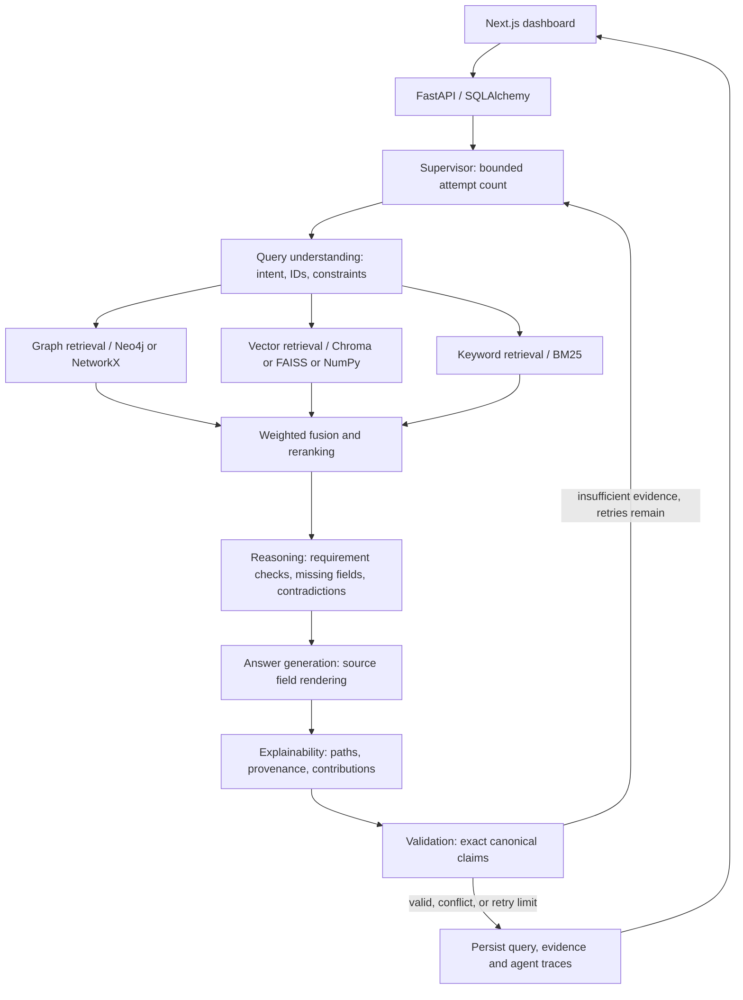
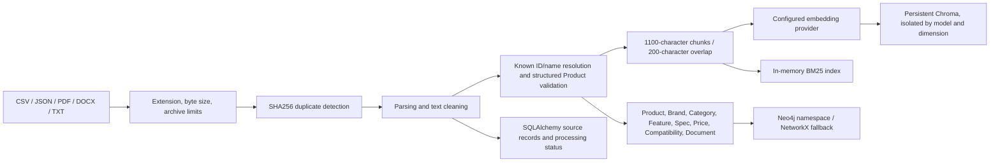

# System architecture

## Boundaries

The backend owns secrets, parsing, retrieval, validation, and persistence. The browser requests relative `/api` URLs through a Next.js proxy. The dashboard never creates its own metrics. Queries use a mutation gate to prevent index replacement while parallel retrieval branches read a snapshot. Requests are serialized at that gate; this is a single-process operating model. SQLite and vector files need writable persistent storage.

`services/seed.py` produces deterministic fixtures. `services/ingestion.py` parses and indexes uploads. `graphrag/engine.py` implements all retrieval channels and the graph/vector adapters. `agents/workflow.py` owns the ten functions and conditional StateGraph. `evaluation/runner.py` computes the benchmark. `main.py` exposes and validates HTTP operations. Frontend components call those endpoints using Axios and typed interfaces.

## Evidence lifecycle

Each document has immutable identity, content hash, original filename, origin, synthetic flag, extracted pages, chunks and linked product IDs. PDF pages are original one-based page indices. TXT/JSON/CSV use logical page 1. DOCX uses page 0 because source pagination cannot reliably be recovered. Canonical structured records have `SRC-<product ID>` sources. Structured product edits replace that canonical source and rebuild indexes; arbitrary supporting uploads are preserved and conflicting keyed numbers are flagged.

Vector scores use nonnegative cosine similarity. BM25 and graph values are normalized by their largest score within the query channel. Weighted contributions sum to the stored fusion score (default .40/.25/.25/.10). A 1.1 multiplier reranks constraint-bearing product matches. This is an explicit heuristic, not a fitted relevance model. Deduplication is by linked product set, with unlinked text retained by chunk identity. Canonical evidence can be added after ranking to substantiate factual fields.

## Runtime visibility

`/api/system/status` reports graph, vector, embedding, LLM, orchestration, database, authentication, and warnings. No endpoint returns an LLM key, database password, or connection credential. `/api/agents/traces/{id}` returns execution timestamps, duration, input/output summaries and trace identity. Trace summaries expose transformations, not private hidden chain-of-thought.
